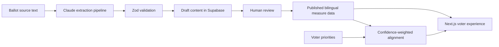

# Civic Mirror

Civic Mirror is a bilingual LA County ballot guide that helps voters connect their priorities
to plain-language explanations of local measures. A short quiz organizes the ballot around the
topics a voter cares about, then exposes the alignment reasoning, tradeoffs, and supporting sources
without telling the voter how to vote.

[Portfolio case study](https://angel-gonzalez-dev.vercel.app/work/civic-mirror) | [Application](https://web-tau-drab-10.vercel.app/en)

**Development dataset:** The repository uses reconstructed representative sample
content for product and extraction testing. It is not an official voter guide and should not be used
to make voting decisions.

## Product experience

- English and Spanish voter routes with equal content structure
- Priority quiz, ballot overview, measure detail pages, and shareable summaries
- Confidence-weighted alignment scoring with contributing topics exposed
- Admin review surface for draft measure content
- Schema-validated Claude ingestion for summaries, impacts, arguments, funding, and citations
- Supabase publication workflow that keeps draft content out of public responses

## Architecture



The web application and ingestion pipeline are deliberately separate. Model output is treated as a
draft, validated against a strict schema, and reviewed before publication. Row Level Security exposes
only published measures to the public anonymous key.

## Repository structure

```text
apps/
  web/       Next.js voter experience and admin review surface
  ingest/    Claude extraction, validation, and Supabase upsert pipeline
supabase/
  migrations/  Schema, topic taxonomy, publication state, and RLS policies
```

## Stack

- Next.js 16, React 19, TypeScript, Tailwind CSS
- next-intl for English and Spanish routes
- Supabase and PostgreSQL with Row Level Security
- Anthropic Claude for structured source-text extraction
- Zod for runtime validation

## Local setup

### Voter application

```bash
cd apps/web
npm ci
copy .env.example .env.local
npm run dev
```

Set the following values in `apps/web/.env.local`:

```text
NEXT_PUBLIC_SUPABASE_URL=
NEXT_PUBLIC_SUPABASE_ANON_KEY=
SUPABASE_SERVICE_ROLE_KEY=
ADMIN_ENABLED=
```

`SUPABASE_SERVICE_ROLE_KEY` is server-only. Never expose it in browser code or commit a populated
environment file.

### Ingestion pipeline

```bash
cd apps/ingest
npm ci
copy .env.example .env
npm run extract:measure-a
```

The ingest app requires `ANTHROPIC_API_KEY`. Add the Supabase variables used by `src/supabase.ts`
when running an extraction with `--write`.

## Validation

```bash
cd apps/web
npm run lint

cd ../ingest
npm run typecheck
```

GitHub Actions runs both checks on pushes and pull requests.

## Important product decisions

- **Explain alignment.** A score is accompanied by the topics that contributed to it.
- **Treat Spanish as a peer.** English and Spanish share the same schema and require equal review.
- **Keep model output provisional.** Extracted content begins as a draft and requires human review.
- **Prefer uncertainty to false certainty.** Confidence and source coverage are part of the content model.
- **Separate public and privileged access.** The anonymous client can read published content only.

## Current limitations and next validation work

- Replace reconstructed sample inputs with official LA County Registrar source material.
- Complete native-speaker review of voter-facing Spanish.
- Validate extraction quality and citations across a broader set of real measures.
- Add automated tests for alignment scoring, schema validation, and publication boundaries.
- Run moderated usability sessions before a public election-cycle launch.

## Contribution

Civic Mirror was built under ADGO Ventures by Angel Gonzalez and his co-founder. Angel's work includes
product strategy, civic information design, the bilingual voter experience, alignment-system design,
and full-stack implementation.

## License

No open-source license has been selected. All rights are reserved unless a license is added later.
